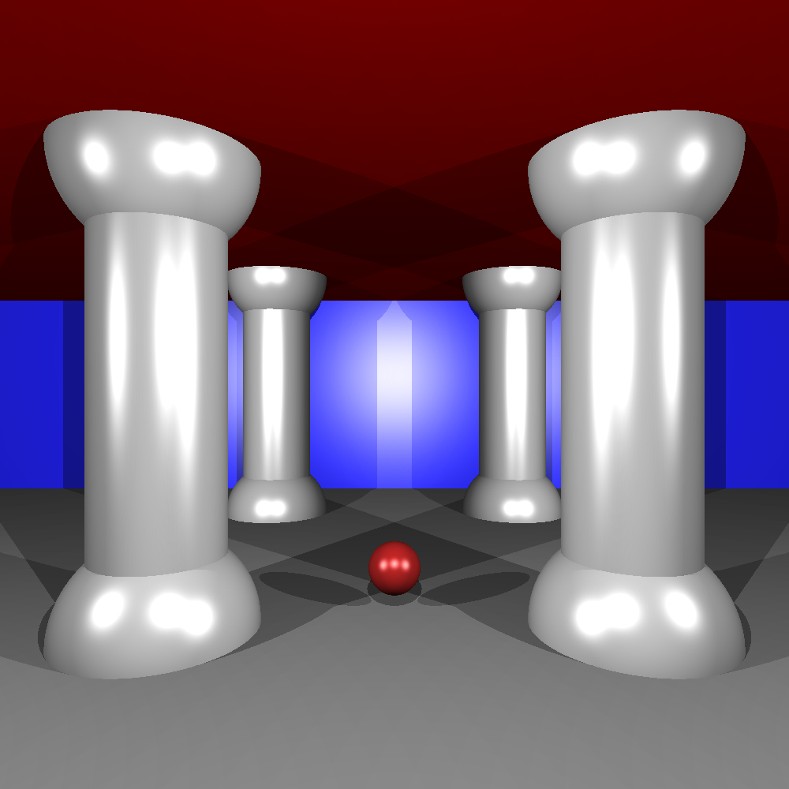
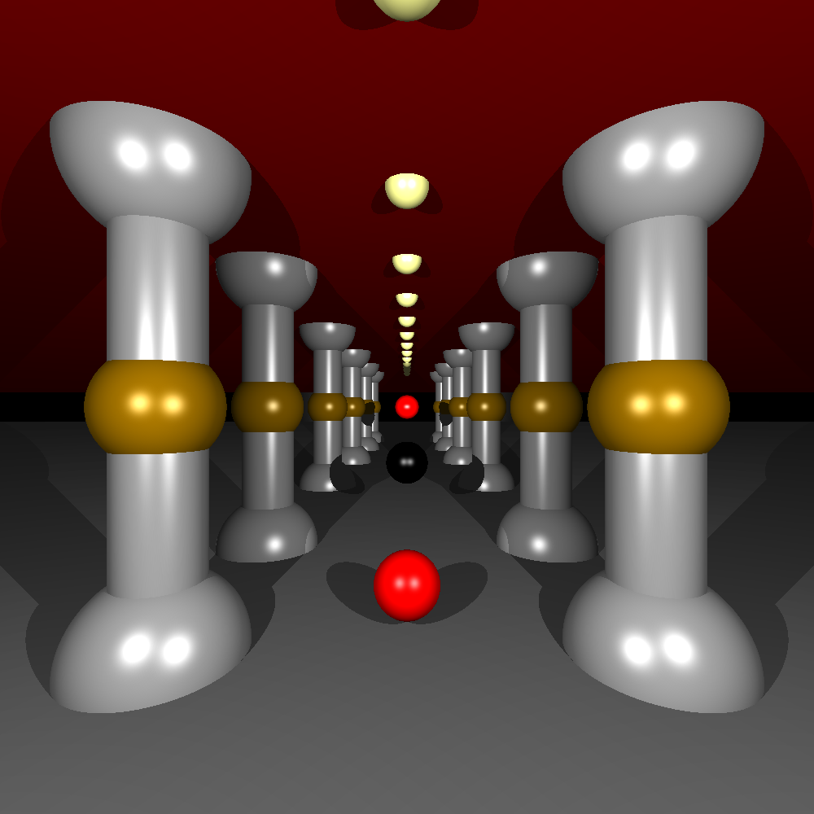
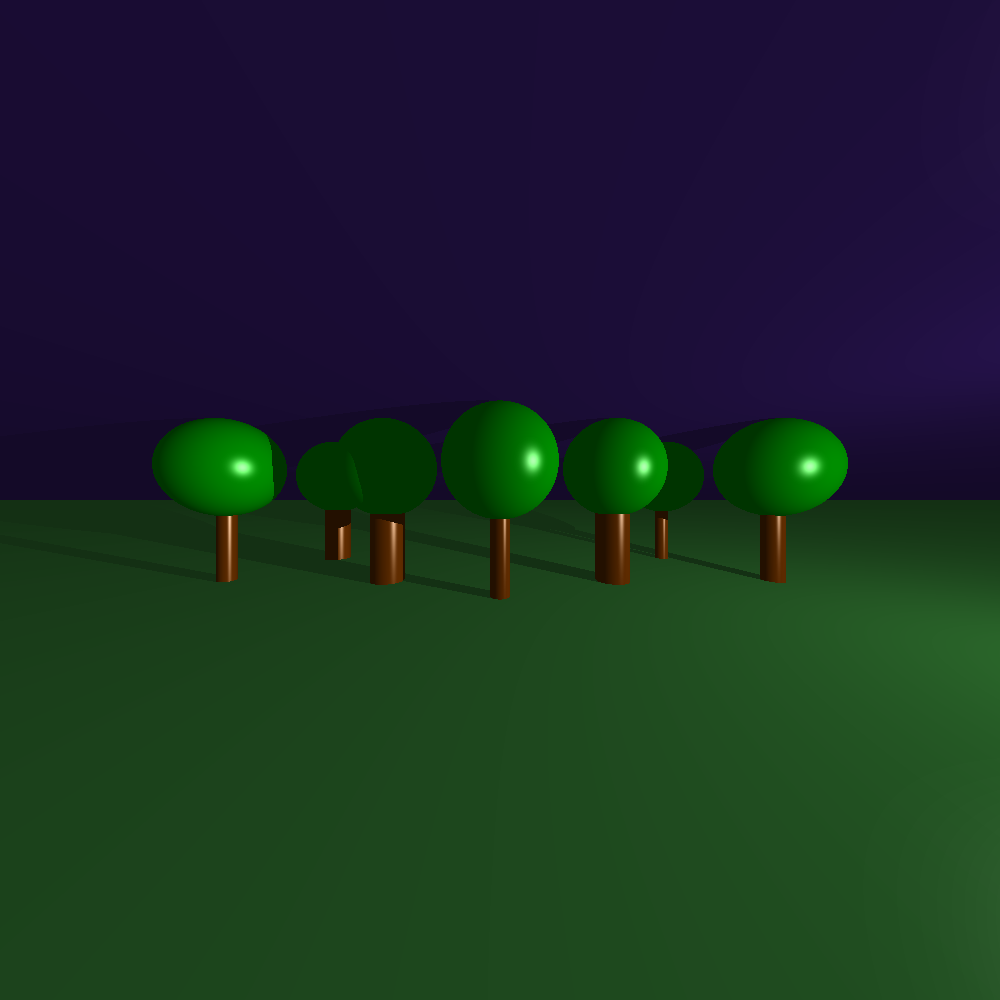

# miniRT — Ray Tracer in C

A ray tracer written from scratch in C. It renders a 3D scene of spheres, planes and cylinders with ambient, diffuse and specular lighting, hard shadows and multiple coloured lights. All vector maths is implemented by hand; [MLX42](https://github.com/codam-coding-college/MLX42) is used only to open the window and put pixels on screen.

Team project by **Kateryna Zinchuk** and **Tetiana Cherniaieva** (see [Team](#team) for who built what).

   <p align="center">
     
     
     
   </p>

## How it works

For every pixel of the window:
1. **Camera ray.** A ray `P(t) = O + t·D` is cast from the camera through the pixel, based on the camera position, view direction and field of view.
2. **Intersection.** The ray is tested against every object in the scene. Each object type has its own maths:
   - **Sphere:** substitute the ray into `|P − C|² = r²` and solve the quadratic for `t`.
   - **Plane:** solve `(P − P₀) · N = 0` for `t`.
   - **Cylinder:** project the ray onto the plane perpendicular to the cylinder axis, solve the quadratic for the body, then check the height limits and the two end caps separately.
3. **Closest hit.** The intersection with the smallest positive `t` is the visible surface.
4. **Lighting.** The colour at the hit point is the sum of:
   - **Ambient** light, so no surface is fully black.
   - **Diffuse** light (Lambert): brightness depends on the angle between the surface normal and the direction to the light.
   - **Specular** highlights, which depend on the viewing direction.
5. **Shadows.** For each light, a shadow ray is cast from the hit point towards the light. If any object is closer than the light, that light doesn't contribute. The ray starts slightly above the surface (an epsilon offset along the normal) to avoid "shadow acne", where a surface wrongly shadows itself because of floating-point error.

## Scene file

Scenes are described in `.rt` files, one element per line:

```
A  0.2                  255,255,255          # ambient: ratio, colour
C  0,5,-14   0,0,1      70                   # camera: position, direction, FOV
L  0,7,-10   0.6        255,255,255          # light: position, brightness, colour
sp 0,1,-1    1.2        125,25,25            # sphere: centre, diameter, colour
pl 0,0,0     0,1,0      200,200,200          # plane: point, normal, colour
cy -5,0,-2   0,1,0      2.8   20   140,140,140   # cylinder: centre, axis, diameter, height, colour
```

The parser validates every line (identifiers, number formats, colours in 0–255, direction components in −1…1), normalises direction vectors and reports clear errors for invalid scenes.

## Build and run

Requires `cmake` and `glfw` for MLX42.

```bash
git clone --recursive https://github.com/katerynazinchuk/miniRT.git
cd miniRT
make
./minirt maps/columns.rt
```

Press `Esc` or close the window to quit.

## Project structure

```
src/
├── math/           # vector operations: add, subtract, scale, dot, cross, normalise
├── parser/         # reading and validating .rt scene files
├── intersections/  # camera rays, sphere / plane / cylinder hits, closest hit
├── light/          # ambient, diffuse, specular lighting and shadows
└── main.c
maps/               # example scenes
notes/              # notes on FOV, shadow bias and design
```

## Team

**Kateryna Zinchuk**
- Vector maths library
- Base scene parser (data structures, element identifiers, vector and colour parsing)
- All object maths: ray intersection with spheres, planes and cylinders (body and caps), closest-hit logic
- Ambient and diffuse lighting, shadows
- Documentation of the intersection maths

**Tetiana Cherniaieva**
- Camera and field of view (ray per pixel)
- Window and pixel drawing with MLX42, colour conversion, build setup
- Parser extension: object arrays for multiple objects and multiple lights, line validation, error handling and reporting
- Specular highlights, coloured and multiple lights
- Rendering optimisation (dithered drawing)

Part of the [Codam](https://www.codam.nl/) (42 Network) curriculum.
